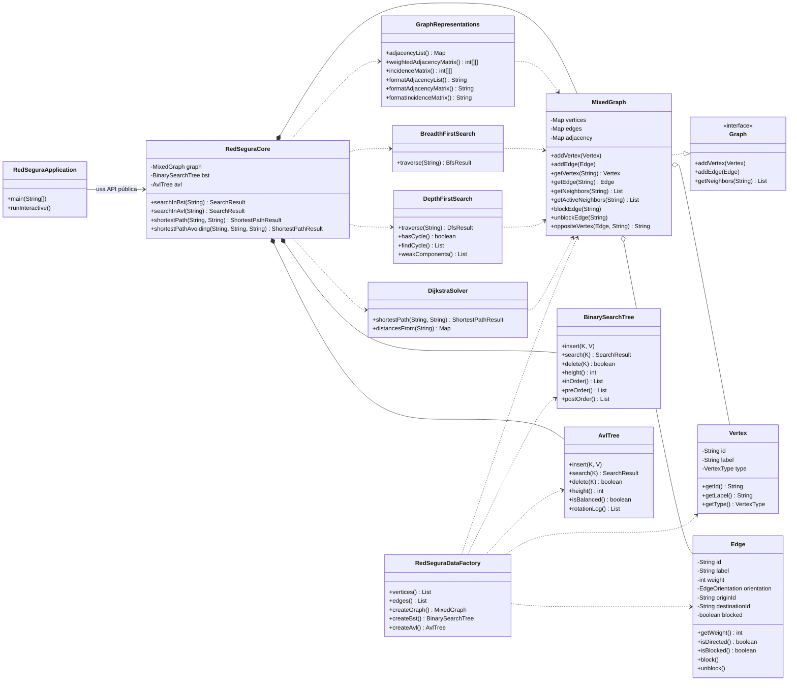
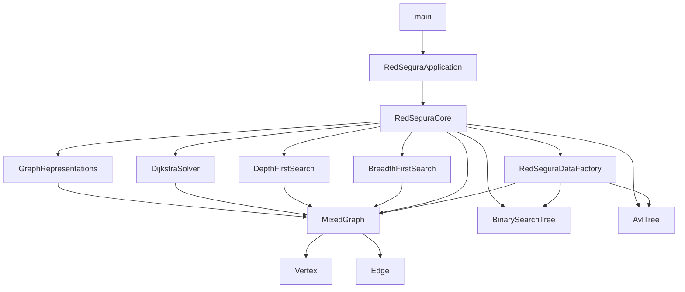

# Diagrama de clases y dependencias — RedSegura

## 1. Diagrama de clases simplificado

## 2. Flujo de dependencias en ejecución

## 3. Regla de encapsulamiento

- `RedSeguraApplication` solo conversa con `RedSeguraCore`.
- Los algoritmos reciben `MixedGraph` por constructor y usan métodos públicos.
- Ninguna clase lee directamente campos privados de otra.
- Los resultados (`BfsResult`, `DfsResult`, `ShortestPathResult`, `SearchResult`) son objetos de solo lectura con listas y mapas copiados.
- `GraphRepresentations` entrega arreglos nuevos en cada llamada, de modo que la vista no modifica el estado interno del grafo.
